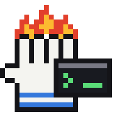
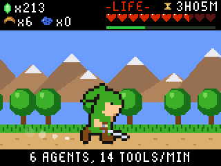
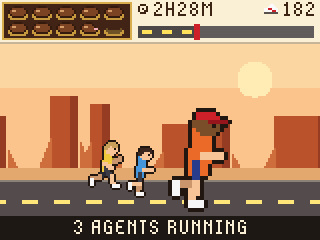
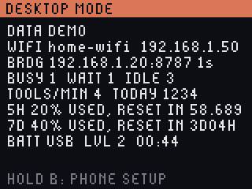
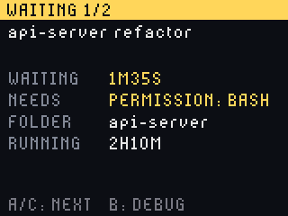
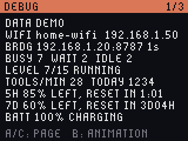
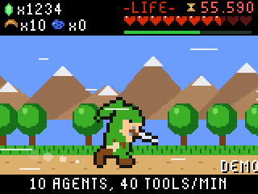

# Burn Helper

Your Claude Code agents as a pixel game on a Pimoroni Tufty 2350 conference badge.

A pixel-art character on the badge sleeps, idles, walks, runs or sprints depending on
how many Claude Code agents are working across your sessions. Ten hearts (or chocolates, or
collar lights, depending on the theme) show how much of your 5-hour usage limit is left,
with a countdown to the next reset; a second meter shows the weekly limit. There are three
themes: a Zelda-style field, *The Running Man* game show, and Forrest Gump's run across
America.

Real screenshots from the badge (Zelda, Running Man and Forrest themes):

  

Press **B** for Desktop mode: usage left and the sessions waiting for you, with **A**/**C**
to see what each one needs. **B** again for Debug mode (shown in demo mode, with example
network details):

  

## Install

There are three ways to set it up, from simplest to most involved. Everyone starts with the first;
the other two add to it, on their own or together:

| Setup | What it gives you | What you add |
|---|---|---|
| [1. One Mac, at home](#1-one-mac-at-home) | The badge shows the agents on your Mac, over the USB cable or your home Wi-Fi | The one-line installer |
| [2. Away from home](#2-away-from-home) | The badge works on any Wi-Fi with internet, such as a phone hotspot or a conference network, while the Mac stays home | A free Tailscale account and one command on the Mac |
| [3. More computers](#3-more-computers) | Agents on your Windows PCs, Linux boxes or other Macs count too | One command on each computer |

### 1. One Mac, at home

You need a Mac, the badge, a USB-C **data** cable, and Claude Code already set up (run it once).
Plug the badge in, then paste this into Terminal:

```
curl -fsSL https://raw.githubusercontent.com/pureyang/burn-helper/main/install.sh | bash
```

The installer asks before each change. It:

1. Installs the Mac bridge (async Claude Code hooks, a hearts status line, a login item;
   `~/.claude/settings.json` is backed up first).
2. If the badge isn't on stock firmware, backs up its whole flash and then flashes Pimoroni's.
3. Asks for your Wi-Fi name and password and **tests the join from the badge itself**, so a
   typo is caught now. A combined 2.4/5 GHz network is fine: use its normal name, because the
   badge joins the 2.4 GHz side. Skip it and set Wi-Fi from your phone later (hold **B**).
4. Copies the app onto the badge and checks that it starts.

That's all for this setup. On the cable the badge needs no Wi-Fi at all; unplugged, it finds the
bridge on your network by itself. If the badge stops answering during the install, the installer
asks you to press its **RESET** button and carries on once it responds.

Handy options (after `| bash -s --`): `--yes` (no questions), `--no-flash`, `--dry-run`,
`--uninstall`. Wi-Fi not connecting? See [Wi-Fi troubleshooting](docs/wifi.md#wi-fi-troubleshooting).

### 2. Away from home

On another network the badge can't find the bridge by itself, so the Mac publishes a small
read-only relay through your own Tailscale account. The badge switches to it after about 10
seconds without the bridge nearby, and back again when you're home.

1. Install [Tailscale](https://tailscale.com/download) on the Mac and sign in (the free plan works).
2. On the Mac: `python3 ~/burn-helper/bridge/relay.py on`
3. Plug the badge into the Mac once. It shows **INTERNET RELAY READY**.
4. Wherever you are, join the badge to the local Wi-Fi from your phone (hold **B**). A phone
   hotspot works; on iPhone, turn on *Maximize Compatibility* so it runs at 2.4 GHz.

Keep the Mac awake and online while you're away. The first time, Tailscale's public address
can take 10 to 20 minutes to appear; `relay.py status` tells you when it answers. Details and
troubleshooting: [away from home](docs/relay.md).

### 3. More computers

The badge counts the sessions on the Mac. To count the agents you run on other computers too,
point each one at the Mac. It needs Python 3 there (`py --version`). On Windows, in PowerShell:

```powershell
git clone https://github.com/pureyang/burn-helper $HOME\burn-helper
py $HOME\burn-helper\bridge\install.py --bridge http://<your-mac>:8787
```

On Linux or another Mac it's the same with `python3`. Then restart Claude Code on that computer.
For `<your-mac>`, use the Mac's IP address if the computer is only ever on your home network, or
the Mac's Tailscale name if it's on your tailnet, which works from anywhere. (The relay from
setup 2 won't do here: its `https://` address is read-only, for the badge.) Step by step, with a check that it
works: [other computers](docs/other-computers.md).

## What the badge shows

The character speeds up with the number of agents working (busy sessions plus running
subagents), over 15 levels:

| Agents working | Level | The character |
|---|---|---|
| none | asleep or idle | asleep (nothing for 5 minutes) or standing by |
| 1 to 3 | 1 to 3 | walking |
| 4 to 7 | 4 to 7 | running |
| 8 to 10 | 8 to 10 | sprinting |
| 11-25, 26-50, 51-75, 76-100 | 11 to 14 | sprinting, with sparks, then heat haze, then a pulsing edge |
| over 100 | 15, ULTRA | flying through hyperspace |

Every level adds speed and speed lines, so all 15 look different. The character also acts out
what the agents do: a sword combo when one edits a file, a bomb when it runs a command, item get
when it finishes its turn ([all of them](docs/how-it-works.md#what-the-agents-are-doing)). When a
session is waiting for your input the character calls for you, and the optional case LEDs flash. Ten icons show the 5-hour usage limit left, a bar shows the weekly limit, and a
countdown runs to the next reset. See [how it works](docs/how-it-works.md) for the meters and
every theme and level, and [all 15 levels](docs/img/tiers_hero.png) side by side.

## Screens

**B** steps through three modes. None of them turns the screen off, and the two status
modes pause the animation to save battery. Usage is always shown as what is **left**.

- **Animation**: the theme. A/C switch themes here, and only here.
- **Desktop mode**: usage left on the 5-hour and weekly limits, and the sessions waiting for
  you, longest wait first. A/C step through those sessions one at a time: what each needs
  (permission for a tool, or your reply), its folder, and how long it has waited and run.
- **Debug mode**: everything on one page, then the connection and Wi-Fi debug pages (A/C turn
  pages). When Wi-Fi is not working it opens on the Wi-Fi page.

## Buttons

Short presses act when you let go, so holding a button never also triggers its press.



| Button | Action |
|---|---|
| A / C | on the animation: previous / next theme. In Desktop mode: previous / next waiting session. In Debug mode: previous / next page |
| B | next mode: animation, Desktop mode, Debug mode, then the animation again. Hold 2 s for phone setup |
| Hold UP 2 s | demo, hero theme only: a 30-second ramp from asleep through all 15 levels to hyperspace, with sessions waiting now and then, and a DEMO tag. Hold again to stop |
| UP | on the Wi-Fi page of Debug mode: rescan |
| DOWN | brightness: 10 levels, then 0% (screen off, the badge keeps running; a note shows for 3 s first), then full again |
| Hold DOWN 2 s | case LEDs on or off (off by default). When on, they pulse with activity and flash when a session is waiting for you |
| HOME | stock app menu; HOME again comes back |

## Wi-Fi in short

The badge's radio is 2.4 GHz only. A combined 2.4/5 GHz network works under its normal name.
At home the badge must be on the same network as the Mac. Hold **B** for 2 seconds to set Wi-Fi up
from your phone: setup stays open, joins the network on the badge and shows the result. A wrong
password never reports an error on this radio, the badge just stays in "joining". Details,
troubleshooting and shipping badges with an event network are in [docs/wifi.md](docs/wifi.md).
Away from home, see [setup 2](#2-away-from-home).

## Documentation

| Page | What is in it |
|---|---|
| [Hardware and compatibility](docs/hardware.md) | The tested setup, supported and unsupported devices, networks and Macs |
| [Install](docs/manual-install.md) | What the installer does, its options, and the manual steps |
| [Wi-Fi](docs/wifi.md) | Setup from the phone, event networks, troubleshooting |
| [How it works](docs/how-it-works.md) | Bridge, badge app, activity levels, usage meters, every theme |
| [Making themes](docs/themes.md) | The theme contract, memory and build-time budgets, how to add one |
| [Development](docs/development.md) | Simulator, tools, tests, repo layout |
| [Away from home](docs/relay.md) | Reaching your Mac from any Wi-Fi through your Tailscale account |
| [Other computers](docs/other-computers.md) | Counting the agents you run on Windows, Linux or another Mac |
| [Demo video](docs/video.md) | Recording the 20-second demo take the badge plays on its own |
| [Bridge](bridge/README.md) | The Mac-side server and its API |
| [Desk stand](stand/README.md) | A 3D-printable stand that keeps the badge upright with the USB-C cable plugged in, with an optional two-colour heart meter |

## License

[MIT](LICENSE) for the code. The license does not cover the names and characters the homage
themes refer to (Zelda, *The Running Man*, Forrest Gump); those belong to their owners.

## Private data

Flash backups (`backup/`), firmware images, raw dumps and `badge/secrets.py` are git-ignored
because they can hold Wi-Fi passwords and keys. Never commit them.
