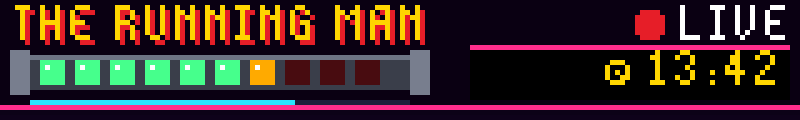
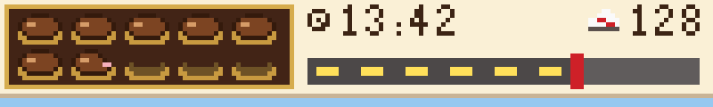

# tufty-badge

Live Claude Code activity on a Pimoroni Tufty 2350 conference badge.

A pixel-art character on the badge sleeps, idles, walks, runs or sprints depending on
how many Claude Code agents are working across your sessions. A row of hearts shows how
much of your 5-hour usage limit is left, and a second meter shows the weekly limit. There are
three themes: a Zelda-style field, *The Running Man* game show, and Forrest Gump's run
across America.


Real screenshots from the badge:

  

## Hardware

### The combination that works today

This is the exact setup this repo was built and tested on:

| Part | Tested with |
|---|---|
| Badge | Pimoroni **Tufty 2350**, the edition handed out at **Supabase Select 2026**. It has an RP2350 (rev A4) with 16 MB of flash and a 320×240 colour screen, which the app drives at 160×120 pixel-doubled. Its radio is a Raspberry Pi CYW43439 module (2.4 GHz only), with four case LEDs and a USB-C port |
| Badge firmware | Stock Pimoroni Tufty 2350 MicroPython **v3.1.1** "with filesystem", from [pimoroni/tufty2350 releases](https://github.com/pimoroni/tufty2350/releases). It reports `tufty 3.4.0`, MicroPython bw-1.29.0-gc. This replaces the conference firmware |
| Computer | **Mac mini (Mac18,5, Apple silicon), macOS 27.0** (build 26A428) |
| Mac software | The Apple-supplied `/usr/bin/python3` 3.9.6 (no extra packages), `picotool` 2.3.1 from Homebrew, and **Claude Code 2.1.295 / 2.1.296** (native install) |
| Link | **USB-C data cable from the badge to the Mac**: confirmed working end to end |

**Wi-Fi status:** the Wi-Fi code path works in testing. Discovery and polling were tested
against the live bridge, and the badge's setup hotspot works. A Wi-Fi network has not yet been
confirmed end to end in the test environment. The home network tried so far never accepted the
badge, which shows as STUCK on the debug screen. Use the
[Wi-Fi troubleshooting](#wi-fi-troubleshooting) steps to find out why.

### Compatibility

| Device or setup | Status |
|---|---|
| Tufty 2350, Supabase Select 2026 edition | **Tested** (after reflashing to stock firmware, below) |
| Tufty 2350, retail Pimoroni unit | Should work: same board and same stock firmware. Not tested |
| Pimoroni firmware v4.0.0-ide.1 or later | Not tested. Stay on v3.1.1 unless you want to try |
| Badger 2350 (e-ink), Blinky 2350 (LED matrix) | Not supported. They run the same framework, but the themes are drawn for the Tufty's colour screen |
| Tufty 2040 (older badge) | Not supported: no Wi-Fi and a different firmware/API |
| Other Macs on recent macOS with `/usr/bin/python3` 3.9+ | Should work. Only the Mac above is tested |
| Linux / Windows as the bridge host | Not supported yet. The server is plain Python, but install, USB detection and the login item are macOS-specific (`launchd`, `ioreg`) |
| Claude Code versions | Needs a version that writes `~/.claude/sessions/*.json` and puts `rate_limits` in the status-line JSON. 2.1.295+ does |
| Wi-Fi: 2.4 GHz, WPA2 (or WPA2/WPA3 mixed) with a password | Supported |
| Wi-Fi: 5 GHz only, WPA3 only, enterprise (802.1X, eduroam) or captive-portal hotel/conference networks | Not supported by the badge |
| Phone hotspot | Supported. On iPhone turn on *Maximize Compatibility* so it runs at 2.4 GHz. The Mac must join the same hotspot |

## How it works

```
Claude Code sessions ──hooks + status line──▶ bridge (Mac) ──Wi-Fi or USB──▶ badge
  ~/.claude/sessions/*.json ─────────────────▲        ▲
                                                    phone browser (theme picker)
```

- **bridge/tufty_bridge.py** runs on the Mac. It reads Claude Code's live session registry
  (`~/.claude/sessions/*.json`, which says which sessions are busy, idle or waiting for you).
  It also takes tool-call events from a hook and usage limits from the status line, and serves
  one small JSON document at `/status`. It announces itself on the LAN with a UDP beacon, and
  when the badge is plugged into the Mac it also pushes the same JSON down the USB cable.
- **The status line** gets the official `rate_limits` numbers from Claude Code: 5-hour and
  7-day usage, account-wide. It prints hearts in your terminal too.
- **The badge app** (`badge/apps/claude_buddy`) joins Wi-Fi, finds the bridge by its beacon,
  polls it every 2.5 s without blocking the animation, and draws the theme. All sprites are
  generated on the badge from a tiny posed skeleton (`figure.py`), so the walk, run and sprint
  cycles stay consistent across themes.

### Activity levels

| Level | When | Zelda | Running Man | Forrest |
|---|---|---|---|---|
| 0 asleep | nothing busy for 5 min | Link asleep under the stars | runner asleep on the concrete, OFF AIR | on the bench with his chocolates |
| 1 idle | recently active, or a session waiting | standing guard | limbering up, STANDBY | standing by the bench |
| 2 walk | 1 agent busy | walking the field | jogging into the Zone, LIVE | jogging a country road |
| 3 run | 2–3 agents, or ≥15 tool calls/min | Pegasus-boots dash | a stalker on his heels | bearded, Monument Valley |
| 4 sprint | 4+ agents, or ≥40 tool calls/min | sword dash + spin attacks | explosions, searchlights | a crowd of followers, one per agent |

When any session is waiting for your input, Navi shouts "HEY! LISTEN!", the Running Man
audience votes "YOUR MOVE!", or Forrest yells "JENNY!". The badge's four case LEDs blink too.

### Usage meters

Every theme shows the 5-hour limit as ten icons, the weekly limit as a bar, and a countdown
to the next 5-hour reset. Each icon is 10% of the limit left and a half icon is 5%. The icons
flash once less than 20% is left.

| Theme | 5-hour limit | Weekly limit | Countdown |
|---|---|---|---|
| Zelda | Hearts: full, half, empty | Green magic meter under the hearts | Hourglass beside "-LIFE-" |
| Running Man | The runner's explosive collar: green light = charge left, amber = half, dark red = spent; the collar flashes red when low | Cyan charge strip under the collar | The show's game clock |
| Forrest | A box of chocolates: whole, bitten (half), empty paper cup | The road from coast to coast | Clock beside the miles |





The countdown shows hours and minutes while the reset is far off (`2H13M`). Under an hour it
becomes a ticking clock (`13:42`), under a minute it shows milliseconds (`42.173`), and in the
last ten seconds microseconds (`9.173248`). It turns yellow under 10 minutes and red under one.
After the reset it shows `RESET!` for a minute, then `FULL`. The badge redraws 25 times a
second, so the last digits blur by design. The countdown runs on the badge's own clock,
synced to the bridge, so it ticks smoothly between updates.

**How often the numbers update:** the usage percentages come from Claude Code's status line.
The status line reruns after every Claude response and at least every 60 seconds in each
open session (`refreshInterval` in `~/.claude/settings.json`), and the badge picks the new
value up within 2 to 3 seconds. With no Claude Code session open, the last value stays. The
meters stay grey until a status line has reported usage, which only happens on Claude
subscription accounts. The terminal status line shows `resets in 1h23m`, and the phone panel
runs the same live countdown as the badge.

## Installation

You need the badge, a USB-C **data** cable, a Mac with Claude Code installed, and Homebrew.

### 1. Get the tools and the code

```
brew install picotool
git clone https://github.com/pureyang/tufty-badge.git
cd tufty-badge
```

Download `tufty-v3.1.1-micropython-with-filesystem.uf2` from the
[Tufty 2350 v3.1.1 release](https://github.com/pimoroni/tufty2350/releases/tag/v3.1.1)
into a `firmware/` folder (`mkdir -p firmware`).

### 2. Back up the badge

Plug the badge into the Mac. The conference build is running and shows up as
`/dev/cu.usbmodem*`. Reboot it into its bootloader, then save and verify all 16 MB of flash:

```
python3 scripts/badge.py bootloader
mkdir -p backup/$(date +%F)
picotool save -a backup/$(date +%F)/flash-full.bin
picotool verify -o 0x10000000 backup/$(date +%F)/flash-full.bin
```

If `bootloader` cannot reach the badge, hold **HOME** while pressing **RESET** instead. The
backup contains the conference Wi-Fi password and keys. `backup/` is git-ignored, so keep it
that way.

### 3. Flash the stock firmware

```
picotool load -v -x firmware/tufty-v3.1.1-micropython-with-filesystem.uf2
```

The badge restarts into Pimoroni's launcher. To go back to the conference firmware later, run
`picotool load -v -x backup/<date>/flash-full.bin` from the bootloader.

### 4. Tell the badge your Wi-Fi (optional now, you can use your phone later)

```
cp badge/secrets.example.py badge/secrets.py   # git-ignored
# edit WIFI_SSID / WIFI_PASSWORD: a 2.4 GHz network the Mac is also on
```

### 5. Install the app on the badge

```
python3 tools/deploy.py --all
```

This copies `badge/` onto the badge's `/system` over USB, which takes about 40 s, then
restarts it. From now on the badge boots straight into the app. Later deploys only send
changed files.

### 6. Install the bridge on the Mac

```
python3 bridge/install.py --dry-run   # shows exactly what will change
python3 bridge/install.py
```

This backs up `~/.claude/settings.json`, then adds the async hooks and the hearts status line,
and starts the bridge as a login item. The log is at `~/Library/Logs/tufty-bridge.log`. Restart
open Claude Code sessions so they pick up the hooks. To remove everything it added, run
`python3 bridge/install.py --uninstall`.

### 7. Check it

```
curl -s http://127.0.0.1:8787/status    # level, busy, hearts...
```

- With the badge on USB it should show your activity within a few seconds. Press **B** and the
  first info line should read `DATA USB CABLE`.
- Open `http://<your-mac-ip>:8787/` on your phone for the status panel and theme picker.
- Unplug the badge to run on Wi-Fi. Press **B** twice for the Wi-Fi debug screen if it doesn't
  connect.

## Putting the badge on Wi-Fi

The badge radio is **2.4 GHz only**, and the badge must be on the **same network as the Mac**
so it can hear the bridge's beacon.

- **From your phone:** hold **B** for 2 seconds. The badge becomes a hotspot and shows a QR
  code. Scan it, open `http://192.168.4.1`, and tap one of the networks the badge can see. Then
  type the password, using *Show password* to check it. The badge restarts and joins.
- **From the Mac:** edit `badge/secrets.py`, then run `python3 tools/deploy.py`.
- **No discovery?** If your network blocks broadcasts, set a fixed bridge address
  (`BRIDGE = "192.168.x.y:8787"` in `secrets.py`, or the portal's bridge field).

## Wi-Fi troubleshooting


**On the badge:** press **B** twice to open the Wi-Fi debug screen. Each saved network gets a
line with its channel, signal strength and a verdict, and a plain-language hint sits at the
bottom. Press **UP** there to rescan and retry immediately.

**On the Mac:** with the badge plugged in and the app running, this prints the full diagnosis
and the recent network log. It shows password lengths but never the passwords themselves.

```
python3 tools/netdebug.py
```

| Verdict | Meaning | What to do |
|---|---|---|
| `NOT SEEN` | The badge can't hear that network name | It is 5 GHz only, hidden, or out of range. Use the router's 2.4 GHz name, or a phone hotspot with *Maximize Compatibility* |
| `STUCK` | The router never let the badge in. The join never completed and no error came back | Most often a wrong password. Re-enter it with *Show password*; the badge trims a stray trailing space automatically. Otherwise the router is WPA3-only (switch to WPA2/WPA3 mixed) or filters MAC addresses (allow the MAC shown on the debug screen) |
| `BAD PW` | The router rejected the password | Re-enter it (hold **B**) |
| `NO IP` | Joined but got no address | The router's DHCP is full or broken; restart the router |
| `OK`, but `BEACON NEVER` | On Wi-Fi but can't hear the bridge | The Mac is on another network or a guest/isolated network, or broadcasts are blocked. Put both on the same network, or set a fixed `BRIDGE` address |
| `OK`, bridge not answering | Found the bridge but the HTTP poll fails | Check `curl http://<mac-ip>:8787/status` from another device, and the macOS firewall |

The network log is also kept on the badge in `/state/claude_buddy_net.log`.

## Buttons

Short presses act when you let go, so holding a button never also triggers its press.


| Button | Action |
|---|---|
| A / C | previous / next theme |
| B | info screen, then Wi-Fi debug screen, then back. Hold 2 s for phone setup |
| Hold UP 2 s | demo mode: cycles every level and a 90-second usage window with its countdown, with a DEMO tag. Hold again to stop |
| UP | on the Wi-Fi debug screen: rescan |
| DOWN | brightness |
| HOME | stock app menu; HOME again comes back |

## Development

```
python3 tools/simulate.py                       # render every theme/level to tools/sim/out/*.png
python3 tools/sim/preview_debug.py              # render the Wi-Fi debug screen states
python3 tools/deploy.py                         # copy changed files to the badge and restart
python3 tools/deploy.py --shot-only x.png [--view 2] [--demo 1]   # screenshot the badge (2 = debug screen, demo 1 = demo)
python3 tools/netdebug.py                       # badge Wi-Fi diagnosis over USB
python3 tools/sim/test_net.py                   # badge networking code against a live local bridge
python3 tools/sim/test_portal.py                # phone setup portal form handling
python3 scripts/badge.py exec "print(1)"        # raw REPL one-liner
```

The simulator (`tools/sim/pvshim.py`) re-implements the badge's `picovector` drawing calls
with the pixel rules measured on the device. These are nearest-neighbour blits and flips, and
the ROM pixel fonts with the firmware's spacing. So the PNGs match the real screen.
`tools/deploy.py` remounts the badge's read-only `/system` volume read-write over serial, so
deploying doesn't need USB disk mode. The badge tools take a lock file so the bridge's USB
tether pauses while they use the port.

## Contents

- `badge/` - everything that goes onto the badge's `/system` (app, `main.py`, secrets template)
- `bridge/` - Mac-side bridge, hook, status line, installer ([details](bridge/README.md))
- `tools/` - deploy, Wi-Fi debug, simulator, tests, icon generator
- `scripts/badge.py` - stdlib serial/raw-REPL helper (also `bootloader`, `disk`, `reset`)
- `scripts/probe_board.py`, `scripts/serial_template.py` - original probe scripts
- `notes.md` - board facts, firmware findings, gotchas

## Not included

Flash backups (`backup/`), firmware images (`*.uf2`), raw dumps (`*.bin`) and
`badge/secrets.py` are git-ignored. They contain Wi-Fi passwords, Supabase keys and device
tokens, so never commit them.
