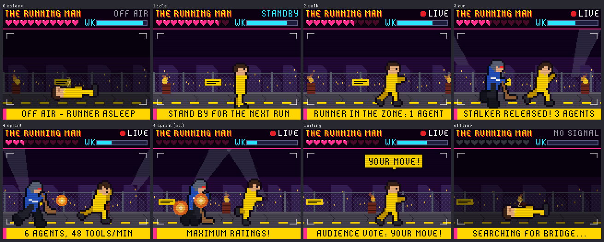
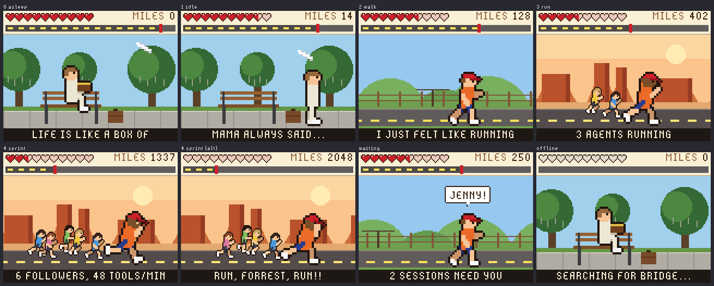
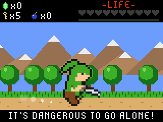
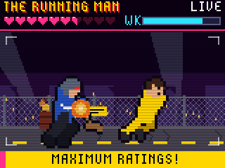

# tufty-badge

Live Claude Code activity on a Pimoroni Tufty 2350 conference badge.

A pixel-art character on the badge sleeps, idles, walks, runs or sprints depending on
how many Claude Code agents are working across your sessions. A row of hearts shows how
much of your 5-hour usage limit is left, and a second meter shows the weekly limit. There are
three themes: a Zelda-style field, *The Running Man* game show, and Forrest Gump's run
across America.





Real screenshots from the badge:

  

## How it works

```
Claude Code sessions ──hooks + status line──▶ bridge (Mac) ──Wi-Fi or USB──▶ badge
  ~/.claude/sessions/*.json ─────────────────▲        ▲
                                                    phone browser (theme picker)
```

- **bridge/tufty_bridge.py** runs on the Mac. It reads Claude Code's live session registry
  (`~/.claude/sessions/*.json`, which says which sessions are busy, idle or waiting for you).
  It also takes tool-call events from a hook and usage limits from the status line, and serves
  one small JSON document at `/status`. It announces itself on the LAN with a UDP beacon, and
  when the badge is plugged into the Mac it also pushes the same JSON down the USB cable.
- **The status line** gets the official `rate_limits` numbers from Claude Code: 5-hour and
  7-day usage, account-wide. It prints hearts in your terminal too.
- **The badge app** (`badge/apps/claude_buddy`) joins Wi-Fi, finds the bridge by its beacon,
  polls it every 2.5 s without blocking the animation, and draws the theme. All sprites are
  generated on the badge from a tiny posed skeleton (`figure.py`), so the walk, run and sprint
  cycles stay consistent across themes.

### Activity levels

| Level | When | Zelda | Running Man | Forrest |
|---|---|---|---|---|
| 0 asleep | nothing busy for 5 min | Link asleep under the stars | runner asleep on the concrete, OFF AIR | on the bench with his chocolates |
| 1 idle | recently active, or a session waiting | standing guard | limbering up, STANDBY | standing by the bench |
| 2 walk | 1 agent busy | walking the field | jogging into the Zone, LIVE | jogging a country road |
| 3 run | 2–3 agents, or ≥15 tool calls/min | Pegasus-boots dash | a stalker on his heels | bearded, Monument Valley |
| 4 sprint | 4+ agents, or ≥40 tool calls/min | sword dash + spin attacks | explosions, searchlights | a crowd of followers, one per agent |

When any session is waiting for your input, Navi shouts "HEY! LISTEN!", the Running Man
audience votes "YOUR MOVE!", or Forrest yells "JENNY!". The badge's four case LEDs blink too.

Hearts: 10 hearts = 100% of the 5-hour limit left; each half heart is 5%. They blink below
2 hearts. Hearts stay grey until a Claude Code status line has reported usage. That only
happens on Claude subscription accounts.

## Setup

### 1. Flash the badge (done once)

The badge was flashed with the stock Pimoroni Tufty 2350 v3.1.1 firmware, which replaces the
SELECT 2026 conference layer. A verified full backup of the conference firmware is in
`backup/2026-10-09/flash-full.bin` (git-ignored, contains credentials). To go back:

```
python3 scripts/badge.py bootloader
picotool load -v -x backup/2026-10-09/flash-full.bin
```

### 2. Install the bridge, hooks and status line on the Mac

```
python3 bridge/install.py --dry-run   # show the settings.json change
python3 bridge/install.py             # install; --uninstall removes everything it added
```

This backs up `~/.claude/settings.json` and then adds async hooks. The hooks never block a
session, and they send only the session id, event name, tool name and hostname. The installer
sets the status line if you have none, and adds a LaunchAgent so the bridge starts at login.
Its log is at `~/Library/Logs/tufty-bridge.log`. Open `http://<mac-ip>:8787/` on your phone for
the status panel and theme picker.

### 3. Put the badge on Wi-Fi

The badge radio is **2.4 GHz only**. Use one of these:

- **From your phone:** on the badge, hold **B** for 2 seconds. It becomes a hotspot. Scan the
  QR code, open `http://192.168.4.1` and add your network. The badge restarts and joins it.
  This is also how to add your phone's own hotspot. On iPhone, turn on *Maximize
  Compatibility* in Personal Hotspot so it runs at 2.4 GHz.
- **From the Mac:** edit `badge/secrets.py` (git-ignored, see `badge/secrets.example.py`),
  then run `python3 tools/deploy.py`.

The badge must be on the same network as the Mac, so it can hear the bridge's beacon. To skip
discovery, set a fixed `BRIDGE = "192.168.x.y:8787"`. While the badge is plugged into the Mac
by USB it gets its data over the cable and needs no Wi-Fi at all.

## Buttons

| Button | Action |
|---|---|
| A / C | previous / next theme |
| B | info screen: data source, Wi-Fi, bridge, raw numbers, battery. Hold 2 s for phone setup |
| UP | demo mode, which cycles every level (good for showing it off) |
| DOWN | brightness |
| HOME | stock app menu; HOME again comes back |

## Development

```
python3 tools/simulate.py                 # render every theme/level to tools/sim/out/*.png
python3 tools/deploy.py                   # copy changed files to the badge over USB and restart
python3 tools/deploy.py --shot-only x.png # grab what the badge is showing right now
python3 tools/sim/test_net.py             # badge networking code against a live local bridge
python3 tools/sim/test_portal.py          # phone setup portal form handling
python3 scripts/badge.py exec "print(1)"  # raw REPL one-liner
```

The simulator (`tools/sim/pvshim.py`) re-implements the badge's `picovector` drawing calls
with the pixel rules measured on the device. These are nearest-neighbour blits and flips, and
the ROM pixel fonts with the firmware's spacing. So the PNGs match the real screen.
`tools/deploy.py` remounts the badge's read-only `/system` volume read-write over serial, so
deploying doesn't need USB disk mode.

## Contents

- `badge/` - everything that goes onto the badge's `/system` (app, `main.py`, secrets template)
- `bridge/` - Mac-side bridge, hook, status line, installer ([details](bridge/README.md))
- `tools/` - deploy, simulator, tests, icon generator
- `scripts/badge.py` - stdlib serial/raw-REPL helper (also `bootloader`, `disk`, `reset`)
- `scripts/probe_board.py`, `scripts/serial_template.py` - original probe scripts
- `notes.md` - board facts, firmware findings, gotchas

## Not included

Flash backups (`backup/`), firmware images (`*.uf2`), raw dumps (`*.bin`) and
`badge/secrets.py` are git-ignored. They contain Wi-Fi passwords, Supabase keys and device
tokens, so never commit them.
