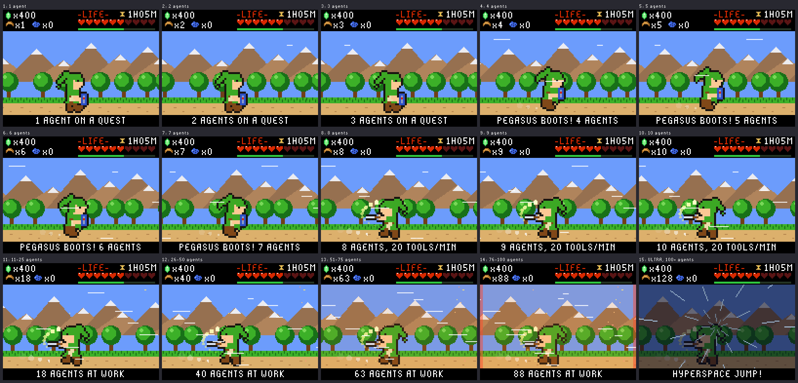
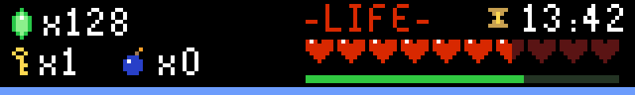
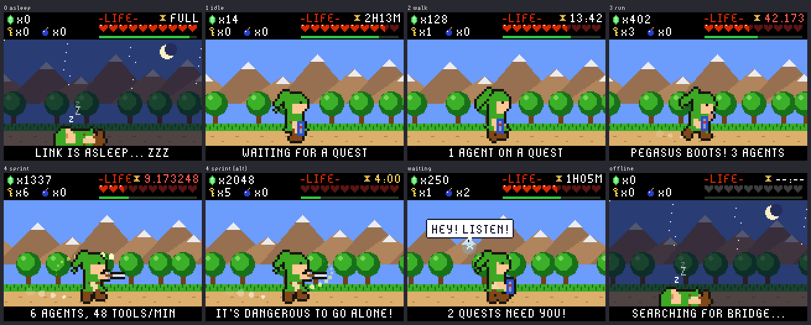
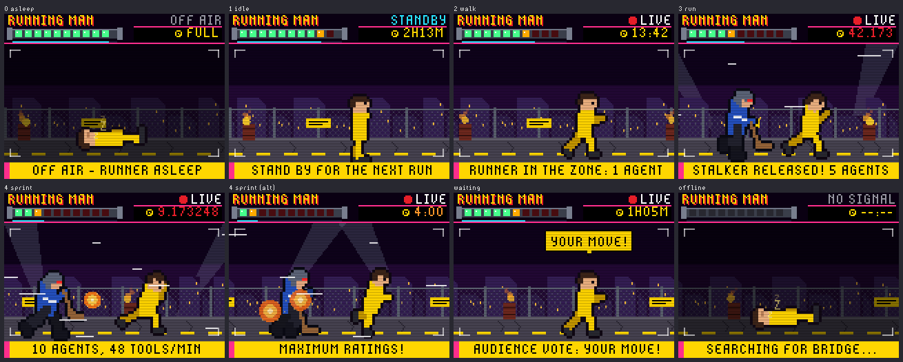
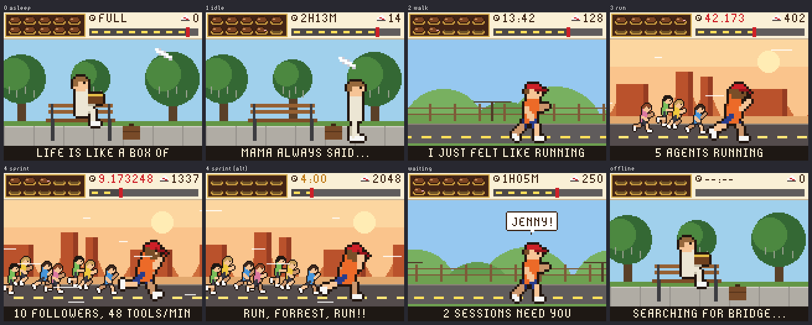

# How it works

```
Claude Code sessions ──hooks + status line──▶ bridge (Mac) ──Wi-Fi or USB──▶ badge
  ~/.claude/sessions/*.json ─────────────────▲        ▲
                                                    phone browser (theme picker)
```

- **bridge/burn_helper_bridge.py** runs on the Mac. It reads Claude Code's live session registry
  (`~/.claude/sessions/*.json`, which says which sessions are busy, idle or waiting for you).
  It also takes tool-call events from a hook and usage limits from the status line, and serves
  one small JSON document at `/status`. It announces itself on the LAN with a UDP beacon, and
  when the badge is plugged into the Mac it also pushes the same JSON down the USB cable.
- **The status line** gets the official `rate_limits` numbers from Claude Code: 5-hour and
  7-day usage, account-wide. It prints hearts in your terminal too.
- **The badge app** (`badge/apps/burn_helper`) joins Wi-Fi, finds the bridge by its beacon,
  polls it every 2.5 s without blocking the animation, and draws the theme. All sprites are
  generated on the badge from a tiny posed skeleton (`figure.py`), so the walk, run and sprint
  cycles stay consistent across themes.

## Activity levels

Agents working means busy sessions plus running subagents. With none working, the bridge's
level decides between asleep (nothing for 5 minutes) and idle. With any working, the badge
picks one of 15 levels from the count (`scene.tier_for`):

| Agents | Level | Gait | Added on top (`fx.py`, every theme) |
|---|---|---|---|
| 1 to 3 | 1 to 3 | walk | faster scrolling each level; speed lines from level 2 |
| 4 to 7 | 4 to 7 | run | more speed lines |
| 8 to 10 | 8 to 10 | sprint | more speed lines |
| 11-25 | 11 | sprint | sparks |
| 26-50 | 12 | sprint | more sparks |
| 51-75 | 13 | sprint | heat haze |
| 76-100 | 14 | sprint | a pulsing red edge |
| over 100 | 15, ULTRA | sprint | the scene dims behind hyperspace star streaks |

The tool-call rate still adds speed. Each theme has its own scenes for the gaits:

| Gait | Zelda | Running Man | Forrest |
|---|---|---|---|
| asleep | Link asleep under the stars | runner asleep on the concrete, OFF AIR | on the bench with his chocolates |
| idle | standing guard | limbering up, STANDBY | standing by the bench |
| walk | walking the field | jogging into the Zone, LIVE | jogging a country road |
| run | Pegasus-boots dash | a stalker on his heels | bearded, Monument Valley, with followers |
| sprint | sword dash + spin attacks | explosions, searchlights | a crowd of followers, up to 7 |



When any session is waiting for your input, Navi shouts "HEY! LISTEN!", the Running Man
audience votes "YOUR MOVE!", or Forrest yells "JENNY!", and the caption line turns into a
waiting bar that names the session, by the name Claude Code shows for it (the one you set with
`/rename`, or the one Claude Code gave it): one stays put, several take turns every 2 seconds
(longest wait first, with a counter), and a name too long for the bar scrolls through once. A
session without a name (an older Claude Code, or a joined computer that doesn't send names yet)
goes by its folder or its computer's name, in grey, numbered only when two look alike. Desktop mode (press **B** once)
lists the waiting sessions by name, and **A**/**C** show each one in detail: whether it needs
permission for a tool (and which) or your reply, its folder, and how long it has waited and
run. The bridge sends each one's title or folder name, cut to 20 plain characters, and the
reason only as a category and tool name, never the notification text. These details are shown
on the badge and in the bridge's `/status` JSON on your network. The badge's four case LEDs can blink too, but they are off by default (hold DOWN for 2 s to switch them on).

## What the agents are doing

The badge also acts out what the agents just did. Each activity plays a short animation once,
on top of the walk or run, then the character carries on:

| Activity | From Claude Code | Zelda | Running Man | Forrest |
|---|---|---|---|---|
| edits a file | Edit, Write, MultiEdit, NotebookEdit | sword combo on a slime | counterattack on a stalker | ping-pong rally |
| reads or searches | Read, Grep, Glob, LS | the lens of truth finds a rupee | searchlights; hides behind a crate | opens the box of chocolates |
| runs a command | Bash | a bomb | barrel blast | shrimp net |
| goes on the web | WebFetch, WebSearch | hookshot | drone cam, "LIVE" | reporters: "WHY ARE YOU RUNNING?" |
| sends out a subagent | SubagentStart | boomerang out and back | a second runner joins | a new follower falls in (and peels off when it is done) |
| a tool call fails | PostToolUseFailure | knocked back, "OUCH!" | zapped, "ZAP!" | shot in the buttocks, "OW!" |
| finishes its turn | Stop | item get, "QUEST COMPLETE!" | the applause sign | turns around at the ocean |
| you send a prompt | UserPromptSubmit | a new quest scroll | the host: "NEXT ROUND!" | drill sergeant: "YES, DRILL SERGEANT!" |
| a session starts | SessionStart | out of a cave | "NEW CONTESTANT" | the bus-stop bench: "HELLO." |
| the usage resets | the hearts jump back up | a heart container | commercial break | a new box of chocolates |

At most one plays every 2 seconds. When several arrive together the badge plays the most
telling: a failure first, then a finished turn, a subagent, your prompt, a new session, and
then tool calls. Anything older than 6 seconds is skipped, so a badge that was away doesn't
replay a backlog. The bridge passes on only the category (`ev` in `/status`), never file names,
commands, URLs or prompts. Both demo modes show them all.

## The weekly reset

The weekly quota's reset is a bigger event than the 5-hour one, and gets louder as it nears (the
5-hour reset is unchanged). Each theme draws every stage its own way:

| Time left | What the badge does |
|---|---|
| under 6 hours | the top-right clock alternates between the 5-hour and the weekly one |
| under 1 hour | the caption carries the weekly countdown, and the weekly meter pulses |
| under 10 minutes | an interstitial for 1.5 s at every whole minute (Navi, the game-show host, the bus at the bench); the case LEDs breathe |
| under 1 minute | a full-screen countdown with the milliseconds (the Triforce builds, the studio "ON AIR" board, Jenny running); the LEDs breathe faster |
| under 10 seconds | huge flashing digits, a flash and an LED pulse on every second |
| the reset | a 4-second celebration (magic restored, a new season, a new box of chocolates) |

A waiting session or an activity animation takes priority over the two full-screen stages, and
the countdown is only shown while the badge knows when the week resets. Demo 1 plays the whole
ladder sped up inside its 90-second window.

## The weekly pace

The weekly meter says how much is left. The pace says whether that is enough for the rest of the
week. The bridge works it out ([bridge/pace.py](../bridge/pace.py)); the badge and the status
line only show it:

| Step | When | What you see |
|---|---|---|
| ✓ calm | most of the time | A tick on every weekly meter where an even pace would leave it now: a bar longer than the tick is under pace. Desktop mode's WEEK line takes turns between the reset, what is likely left at the reset (`PACE: ~33% LEFT AT RESET`) and what that is in work (`~1.5 FULL 5H WINDOWS LEFT`). The status line shows `7d 60% ✓`. |
| ≈ watch | a run-out is 60% likely and due within 3 days | The tick turns yellow, Desktop mode says `AT THIS PACE OUT ~SUN 4PM`, and the status line `7d 64% ≈ at this pace out ~Sun 4pm`. While agents work, the theme's caption says it in its own words for 30 seconds, at most every 4 hours. |
| ! heads-up | a run-out is 85% likely and due within 36 hours, or 90% of the week is used | The same in orange, with how early: `19H BEFORE THE WEEK RESETS`. The caption comes at most every 2 hours. |
| ✗ out | the weekly limit is reached | Desktop mode says `WEEKLY LIMIT REACHED`, and the status line `7d 100% ✗`. |

Nothing is said in the week's first 24 hours. A louder step comes at once; a quieter one only
after the forecast has stayed lower for 2 hours, and then one caption says the pace has eased
(`PACE EASED: MAGIC LASTS`). There are no lights, sounds or full-screen pages for the pace, and a
waiting session's bar always comes first. The captions, per theme:

| | Zelda | Running Man | Forrest |
|---|---|---|---|
| watch | `AT THIS PACE, THE MAGIC` / `RUNS OUT ~SUN 4PM` | `AT THIS PACE THE SEASON` / `ENDS EARLY: ~SUN 4PM` | `AT THIS PACE THE BOX` / `IS EMPTY BY ~SUN 4PM` |
| heads-up | `MAGIC RUNS OUT ~SUN 6PM` / `19H BEFORE THE WEEK RESETS` | `SEASON OVER ~SUN 6PM` / `19H BEFORE THE NEW SEASON` | `BOX EMPTY ~SUN 6PM` / `19H BEFORE A NEW BOX` |
| eased | `PACE EASED: MAGIC LASTS` | `PACE EASED: FULL SEASON` | `PACE EASED: THE BOX LASTS` |
| room left | `35% OF THE MAGIC LEFT` | `35% OF THE SEASON LEFT` | `35% OF THE BOX LEFT` |

**Room left (opt-in).** In the last 12 hours of a week with 20% or more left, one caption says how
much is left and when the week resets, and Desktop mode (`ROOM FOR ~1.3 5H WINDOWS`) and the status
line (`7d 65% ✓ ~1.3 full 5h windows left`) show it for those hours. It reports what is left and
never urges you to use it. Off unless you turn it on, on the bridge computer:
`python3 bridge/install.py --room-left on` (or `off`).

**How it forecasts.** The bridge keeps the weekly percent from each status line report, which hours
of the week agents usually work, and how much of the week one full 5-hour window costs (both
meters' rises between the same reports; about 27% on the bridge where this was built). It reads
this week's use so far against the usual shape of a week, and puts odds on it from how wrong that
reading was on past weeks. With under two weeks recorded it is still learning: the shape comes
from the hours agents work, and the odds are wider. Forecasts always say "at this pace" and carry
a `~`. The thresholds come from a study of thousands of simulated weeks of different kinds of
users; `python3 tools/sim/test_pace.py` replays it against the bridge's code (about 80% of
run-outs flagged 12 hours or more ahead, under 3% missed, under 2% false alarms).

To see every screen, run `python3 tools/sim/preview_pace.py`, or send a pace over USB, for
example `@PACE {"s":1,"cap":"watch","at":"SUN 4PM","even":71}` (`@PACE off` goes back to the
bridge's).

## When the connection is lost

Until the first data arrives after the badge starts, the caption shows what the network is doing
(`SEARCHING FOR BRIDGE...`, `JOINING HOME-WIFI...`) and Desktop mode says `NO DATA YET`. Once data
has arrived, the badge counts from the last update. The data counts as stale 12 seconds after the
last update over Wi-Fi, or 8 seconds over the cable:

| Since the last data | What the badge does |
|---|---|
| under 1 minute | The character stands by: nobody can see what the agents are doing, so nothing is shown working or waiting, the case LEDs stay off and the counts read `x?`. The 5-hour and weekly meters keep their last values but turn grey. The caption alternates between `CONNECTION LOST 0:23` and the reason (`BRIDGE NOT ANSWERING`, `WI-FI FAILING: PRESS B x2`, `REACHING THE RELAY...`). |
| 1 minute or more | The theme's connection-lost page shows how long it has been, the reason and what to try (`IS THE BRIDGE AWAKE?`, or `B x2: THE WI-FI PAGE` when Wi-Fi is the problem). It also shows the usage as of the last data, for example `AS OF 12:41: 5H 95% WK 42%`. On Zelda, the field is dark, Navi asks "?" and a dialog box reads `LOST CONTACT`. On Running Man, colour bars read `PLEASE STAND BY / TECHNICAL DIFFICULTIES` above a `SIGNAL LOST` lower third. On Forrest, he waits on the bench under a bus-stop sign that reads `THE BUS IS LATE`. The page redraws at about 11 frames a second, and dims after 10 minutes without a button press, like a sleeping badge. |
| back again, after the page | For 2.5 seconds the caption reads `THE BRIDGE ANSWERS!`, `WE'RE BACK! LIVE AGAIN` or `HERE COMES THE BUS!`. |

The 5-hour and weekly countdowns keep running throughout, because the reset times do not change.
Desktop mode shows `CONNECTION LOST 4M12S AGO` with the reason and what to try, and the usage rows
dimmed with `AS OF 12:41`. Debug mode's `DATA` row shows `LOST 4M12S AGO`. Lost states use orange
together with the word LOST, and the return uses sky blue together with words, so colour never
carries the message alone. To see these screens without unplugging anything, send `@LOST 90` over
USB (the data is treated as stopped 90 seconds ago; `@LOST -1` ends the test), or run
`python3 tools/sim/preview_lost.py`.

## Usage meters

In the Zelda theme the three counters at the top left are: green gem = tool calls today,
boomerang = agents working right now, ocarina = sessions waiting for you.

Every theme shows the 5-hour limit as ten icons, the weekly limit as a bar, and a countdown
to the next 5-hour reset. Each icon is 10% of the limit left and a half icon is 5%. The icons
flash once less than 20% is left.

| Theme | 5-hour limit | Weekly limit | Countdown |
|---|---|---|---|
| Zelda | Hearts: full, half, empty | Green magic meter under the hearts | Hourglass beside "-LIFE-" |
| Running Man | The runner's explosive collar: green light = charge left, amber = half, dark red = spent; the collar flashes red when low | Cyan charge strip under the collar | The show's game clock |
| Forrest | A box of chocolates: whole, bitten (half), empty paper cup | The road from coast to coast | Clock beside the miles |




**Plans with only a weekly limit.** On a plan with no 5-hour limit, the icons are the weekly limit
(`week` mode). Their countdown is the weekly reset, and the meter under them is the time left in
the week: a row of icons longer than the meter is under pace. The icons likely spent by the reset,
at this pace, go dark for 0.7 s every 2 s. What stays lit is where the week is likely to end. If the
week is on course to run out, every icon goes dark. Desktop mode shows the week, then `AT RESET
~30% LEFT`. The status line marks the spot with a bar: `♥♥♥│♥♥♥♡♡♡♡ · 7d 40% ✓ ends ~70%`. The
bridge switches on its own once Claude Code stops reporting a 5-hour limit. To choose, run
`python3 bridge/install.py --limit week` (or `5h`, or `auto`) on the bridge computer. To see it on
the badge, send `@STATE week` over USB (`@STATE normal` ends it), or run
`python3 tools/sim/preview_week.py`.

The countdown shows hours and minutes while the reset is far off (`2H13M`). Under an hour it
becomes a ticking clock (`13:42`), under a minute it shows milliseconds (`42.173`), and in the
last ten seconds microseconds (`9.173248`). It turns yellow under 10 minutes and red under one.
After the reset it shows `RESET!` for a minute, then `FULL`. The badge redraws 25 times a
second, so the last digits blur by design. The countdown runs on the badge's own clock,
synced to the bridge, so it ticks smoothly between updates.

**How often the numbers update:** the usage percentages come from Claude Code's status line.
The status line reruns after every Claude response and at least every 60 seconds in each
open session (`refreshInterval` in `~/.claude/settings.json`), and the badge picks the new
value up within 2 to 3 seconds. With no Claude Code session open, the last value stays. The
meters stay grey until a status line has reported usage, which only happens on Claude
subscription accounts. The terminal status line shows `resets in 1h23m`, and the phone panel
runs the same live countdown as the badge.

## Every level of every theme

Simulator renders of each activity level, from asleep to sprinting, for each theme.




