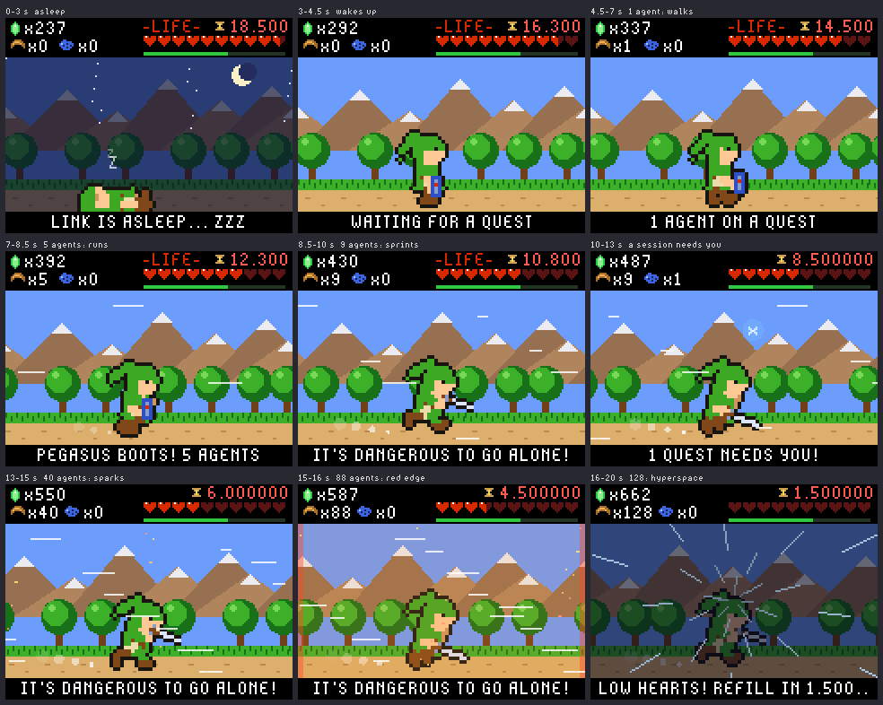

# Recording the 20-second demo video

The badge has a hidden demo built for this video: a 20-second take that goes from asleep to
hyperspace on its own, with a session asking for you in the middle and the hearts draining to
the end. It shows example numbers only, so nothing personal ends up on camera, and it needs no
Mac, bridge or Wi-Fi. It loops every 20 seconds, so you can record a few loops and keep the best.

## Before you record (10 minutes)

- **Badge.** Charged or on a USB-C cable; the cable can stay out of frame. Press **DOWN** until
  the toast says `BRIGHTNESS 100%`.
- **Case LEDs (optional).** They are off by default. To show them pulsing and flashing during
  the take, hold **DOWN** alone for 2 seconds (`CASE LIGHTS ON`). Turn them off the same way
  afterwards.
- **Camera.** A phone on a stand or a stack of books, about 25-30 cm away, the badge filling the
  middle two-thirds of the frame. Record 4K or 1080p at 30 fps.
- **Light.** One lamp from the side and slightly behind the camera, room lights dimmed. Tilt the
  badge about 10 degrees so the lamp does not reflect in the screen.
- **Exposure.** The screen is bright: on iPhone, tap and hold the badge's screen to lock focus
  and exposure (AE/AF LOCK), then drag the sun icon down a step so the pixels are not blown out.
  If you see rolling bands, set 1/50 s or slower in a camera app that allows it.
- **Background.** A plain desk or a lanyard on a dark shirt. Keep laptops with real sessions out
  of the shot.

## Start the take

1. Make sure the animation is on screen (press **B** until it is).
2. Press **UP** and **DOWN** together, at the same moment, and hold both for 3 seconds. The case
   LEDs blink once and the take starts at second 0: the hero falls asleep under the stars. Any
   theme works; the demo switches to the hero theme by itself.
3. Start recording, and let it run for three full loops (about a minute).
4. Hold **UP** and **DOWN** together for 3 seconds again to stop.

Do not touch the buttons during the take: **B** changes the screen and **DOWN** the brightness.

## Shot list

The times are the badge's. Record one continuous shot; the moves below are optional.

| Time | On the badge | Camera | On-screen text (add in the edit) |
|---|---|---|---|
| 0-3 s | Asleep under the stars, "LINK IS ASLEEP... ZZZ" | Wide, still | "My conference badge watches my AI agents" |
| 3-4.5 s | Wakes up and stands | Still | |
| 4.5-7 s | 1 agent: walks | Start a slow push in | "1 agent: walking" |
| 7-8.5 s | 5 agents: runs | Push in | "5 agents: running" |
| 8.5-10 s | 9 agents: sprints, sword out | Hold | "9: sprinting" |
| 10-13 s | A session needs you: "HEY! LISTEN!", the waiting counter goes to 1 | Hold | "A session needs me" |
| 13-16 s | 40, then 88 agents: sparks, then a red pulsing edge | Hold | "40... 88 agents" |
| 16-20 s | 128 agents: hyperspace; the hearts are almost gone and the countdown runs out | Slowly to the hearts | "100+ agents: hyperspace. Hearts = usage left" |

End card (1-2 s, added in the edit): **Burn Helper**, "works with Claude Code, open source",
`github.com/pureyang/burn-helper`.

## Optional voiceover (about 45 words)

Record it on the phone afterwards and lay it under the clip:

> "This is the badge from my last conference. Now it watches my Claude Code agents. One agent,
> he walks. Five, he runs. When a session needs me, he calls me. Over a hundred agents: hyperspace.
> And the hearts? That's the usage I have left."

## Edit and export

- Trim to 20 seconds, starting exactly where the hero is asleep. Add the end card.
- Captions on (most people watch muted). Keep the text in the middle of the frame so it survives
  every crop.
- Export two versions: **1080x1920** (9:16) for YouTube Shorts, TikTok and Reels, and
  **1920x1080** (16:9) for X, Bluesky, LinkedIn and Hacker News.
- A **GIF** for the README: 8-10 seconds (from the wake-up through the sprint), 480 px wide,
  15 fps, under 5 MB. For example: `ffmpeg -ss 3 -t 9 -i take.mov -vf "fps=15,scale=480:-1" demo.gif`

## Extra shots, if you have time

- The badge on a lanyard, walking past the camera (2 s).
- The Mac's terminal with the Claude Code status line showing hearts and the reset countdown.
  Real sessions only; check nothing private is on screen.
- A macro of the hearts while they drain (the last 4 seconds of the take).
