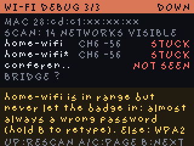

# Wi-Fi

The badge radio is **2.4 GHz only**, and the badge must be on the **same network as the Mac**
so it can hear the bridge's beacon.

- **From your phone:** hold **B** for 2 seconds. The badge becomes a hotspot and shows a QR
  code. Scan it, open `http://192.168.4.1`, and tap one of the networks the badge can see. Then
  type the password, using *Show password* to check it. Setup stays open after you let go of B
  (press B again to cancel). When you tap save, the badge leaves hotspot mode, joins the network
  and shows the result on its screen: the network name and IP address with SUCCESS, then it
  returns to the main screen by itself. If the join fails (wrong password, network not seen) it
  says why and goes back to setup so you can retry.
  The setup hotspot has no password the first time, when no Wi-Fi is saved yet. After that it
  uses an 8-digit password (the shortest WPA2 allows) shown on the badge as `WIFI PASS`; the QR
  code includes it, so you only type it if you join by hand.
- **From the Mac:** edit `badge/secrets.py`, then run `python3 tools/deploy.py`.
- **No discovery?** If your network blocks broadcasts, set a fixed bridge address
  (`BRIDGE = "192.168.x.y:8787"` in `secrets.py`, or the portal's bridge field).
- **Combined 2.4/5 GHz networks work.** Use the shared name (SSID) as is. The badge only hears
  the 2.4 GHz side and joins that.
- **Several saved networks.** The badge tries the one that worked last, then the others in the
  order they were added, and moves on by itself when one goes out of range (it rescans every
  15 s). A network added in phone setup is used straight away, even if setup's test join failed.
  A phone hotspot named with a curly apostrophe (`Sam’s iPhone`) matches a saved name typed with
  a straight one.

## Shipping badges with a conference Wi-Fi pre-stored

This repo ships no Wi-Fi credentials. To hand out badges that join an event network on first
boot, put it in `badge/secrets.py` before deploying (the file is git-ignored; do not commit it):

```python
WIFI_SSID = "EventNetwork"        # must be 2.4 GHz capable (a combined 2.4/5 GHz SSID is fine)
WIFI_PASSWORD = "event-password"
WIFI_EXTRA = [("Backup", "pw")]   # optional, tried in order after the first
BRIDGE = "192.168.x.y:8787"       # recommended at events: broadcast discovery is often blocked
REGION = "us"
TIMEZONE = -8
```

Then run `python3 tools/deploy.py --all` for each badge, which installs the file as
`/system/secrets.py`. Networks a user adds from their phone (hold **B**) are tried first, so
attendees can still override it. Captive portals, 802.1X and WPA3-only networks will not work
(see the table above). Test the password on one badge first with `python3 tools/netdebug.py`:
a wrong password makes this radio sit in "joining" forever instead of reporting an error.
Flash backups of a badge that holds event credentials contain them in plain text, so store
those carefully.

## Wi-Fi troubleshooting



**On the badge:** press **B** twice to open Debug mode. When Wi-Fi is not working it opens on its Wi-Fi debug
page; otherwise press **C** until page 3/3. Each saved network gets a
line with its channel, signal strength and a verdict, and a plain-language hint sits at the
bottom. Press **UP** there to rescan and retry immediately.

**On the Mac:** with the badge plugged in and the app running, this prints the full diagnosis
and the recent network log. It shows password lengths but never the passwords themselves.

```
python3 tools/netdebug.py
```

| Verdict | Meaning | What to do |
|---|---|---|
| `NOT SEEN` | The badge can't hear that network name | It is 5 GHz only, hidden, or out of range. Use the router's 2.4 GHz name, or a phone hotspot with *Maximize Compatibility* |
| `STUCK` | The router never let the badge in. The join never completed and no error came back | Most often a wrong password. Re-enter it with *Show password*; the badge trims a stray trailing space automatically. Otherwise the router is WPA3-only (switch to WPA2/WPA3 mixed) or filters MAC addresses (allow the MAC shown on the debug screen) |
| `BAD PW` | The router rejected the password | Re-enter it (hold **B**) |
| `NO IP` | Joined but got no address | The router's DHCP is full or broken; restart the router |
| `OK`, but `BEACON NEVER` | On Wi-Fi but can't hear the bridge | The Mac is on another network or a guest/isolated network, or broadcasts are blocked. Put both on the same network, or set a fixed `BRIDGE` address |
| `OK`, bridge not answering | Found the bridge but the HTTP poll fails | Check `curl http://<mac-ip>:8787/status` from another device, and the macOS firewall |

The network log is also kept on the badge in `/state/burn_helper_net.log`.
