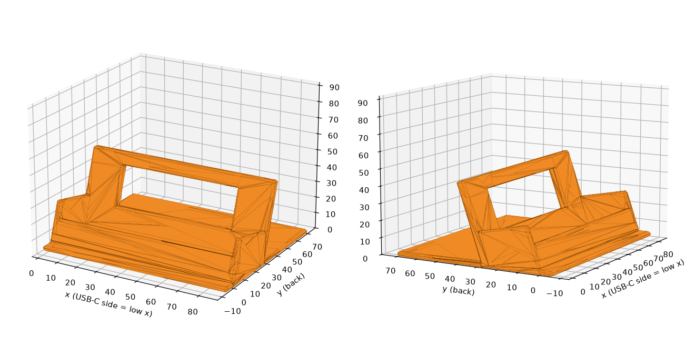
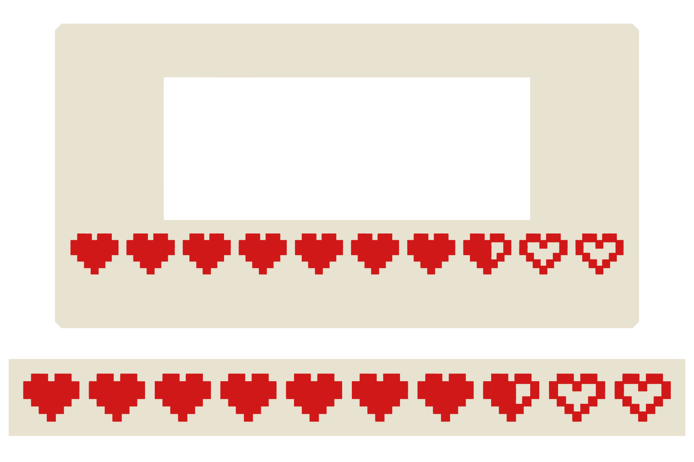

# Desk stand

A 3D-printable stand that holds the Tufty 2350 upright on your desk while a USB-C cable is
plugged into its left side. There are two versions: a plain one in one colour, and one with a
Zelda-style heart meter in a second colour on the front.

Tested with the Tufty 2350 badge given out at Supabase Select 2026. Other Tufty 2350
badges may differ in size or port position, so check the measurements under
[The design](#the-design) before printing.





## Files

| File | What it is |
|---|---|
| `badge_stand.stl` | Plain stand, one colour |
| `badge_stand_2colors_body.stl` | Two-colour stand: the body, in your base colour |
| `badge_stand_2colors_hearts.stl` | Two-colour stand: the hearts, in red |
| `badge_stand_2colors_body.3mf` | Slicer project for the two-colour stand, with the two parts already set up |
| `tufty_stand.3mf` | Slicer project for the first, older version of the stand |
| `badge_stand.py` | Script that builds the plain stand. All sizes are settings at the top |
| `badge_stand_2colors.py` | Script that adds the hearts on top of the plain stand |

## The design

- The badge (85 × 76 × 20 mm) sits in landscape, leaning back 15°, in a slot with 0.8 mm of
  clearance.
- Both side walls are 19.5 mm tall. The USB-C port is 30 mm up the left edge, so the plug
  clears the left wall by about 4 mm and the cable can bend straight down.
- The back wall has a window so the case LEDs on the back still show.
- A foot plate reaches 30 mm behind the stand so it doesn't tip backwards.
- Every outside edge has a 1 mm chamfer, so nothing is sharp to the touch. The inside of the
  slot stays square, so the fit isn't affected.
- The front lip is 9 mm tall and covers the front buttons, which you can't reach while the
  badge is seated anyway.
- The stand is about 92 × 76 × 48 mm.

The two-colour version puts a heart meter of 7 full hearts, 1 half heart and 2 empty outlines
on the front lip, in the pixel style of the original game. Each heart is a 7 × 6 pixel sprite
about 7.4 × 6.3 mm, sunk 0.8 mm into the lip so the surface stays flush.

## Printing

Print flat on the bed as the file is, in PLA or PETG, at 0.2 mm layers and 15 to 20% infill,
with no supports. The top of the back-wall window spans about 56 mm with nothing under it.
Most printers handle that; if yours sags, set `WINDOW = False` and rebuild.

The two-colour version needs a printer that changes filament on its own, because the hearts
are on an upright face and the colour changes on many layers. In Elegoo Slicer, OrcaSlicer
or Bambu Studio:

1. Select both two-colour STLs and import them together.
2. When asked whether to load them as a single object with multiple parts, choose **Yes**.
3. Give the hearts part your red filament and the body your base filament.
4. Make sure the prime tower is on (Process → Others → Prime tower).

## Changing it

You need Python 3 with `manifold3d`, `numpy` and `matplotlib`:

```
pip install manifold3d numpy matplotlib
python badge_stand.py           # plain stand -> badge_stand.stl and .png
python badge_stand_2colors.py   # two-colour stand -> body and hearts STLs and .png
```

Useful settings at the top of `badge_stand.py`:

| Setting | Default | What it does |
|---|---|---|
| `TOL` | 0.8 | Slot clearance in mm. Raise it if the badge is tight, lower it if loose |
| `TILT` | 15 | How far the badge leans back, in degrees |
| `USB_Z`, `PLUG_HALF` | 30, 6.5 | Port height and half the plug height; they set the side wall height. Raise `PLUG_HALF` for a bulky plug |
| `CHAMFER` | 1.0 | Edge bevel in mm. Keep it at 1.5 or less, the walls are 3 mm thick |
| `WINDOW` | True | Window in the back wall for the case LEDs |

In `badge_stand_2colors.py`, `FULL`, `HALF` and `EMPTY` set the number of each kind of heart,
and `PIXEL` sets their size.
